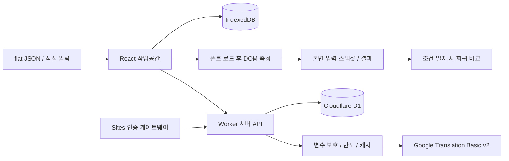

# 구현 구조와 검사 범위

## Gemini 생성형 AI 제안

`app/api/suggest/route.ts`가 로그인·소유권과 일일 횟수를 검사하고 `lib/gemini.ts`로 원문·번역·언어·검사 조건을 전달합니다. Gemini가 JSON 후보를 생성하면 서버가 변수를 검증하며, `components/ai-suggestions.tsx`는 각 후보를 기존 `measureProject`로 실측합니다. 사용자가 후보를 명시적으로 선택하면 문구 적용과 새 검사 이력 저장을 수행합니다. 후보 결과는 기존 `translation_cache`에 `gemini:` 접두사로 구분하여 보관하므로 DB 스키마 변경은 필요하지 않습니다. `translation_requests`와 `quota`에서도 AI 요청을 별도 접두사로 구분합니다.

AI 응답은 의미 정확성이나 픽셀 적합성의 보증이 아닙니다. 원문·현재 번역은 JSON 데이터로 전달하고 AI에게 그 안의 지시문을 따르지 않도록 요청합니다. 화면은 문자열로만 렌더링하고 실행하지 않습니다. API 키는 서버 비밀변수에만 저장합니다. 25초 타임아웃, 모호한 일반 오류 응답, 중복 요청 차단과 사용자별 결과 캐시를 사용합니다.

LocaleBench는 영어 UI 문자열을 독일어·프랑스어·한국어로 번역하고, 번역문이 고정 fixture에 들어가는지 실제 브라우저로 검사합니다. 번역 API 없이도 직접 번역문을 입력하거나 샘플로 전체 검사 흐름을 사용합니다.

## 기술 선택

Sites에서 제공하는 Vinext starter를 유지했습니다. React 19, TypeScript, Next API 호환 App Router를 사용하며 Vite/Vinext가 Cloudflare Worker를 빌드합니다. DB는 D1, 로그인은 Sites의 ChatGPT 인증을 사용합니다. 기본 제안의 Supabase 대신 호스팅에 통합된 DB와 인증을 사용하여 외부 계정·키 수를 줄였습니다. OpenAI API는 서비스 런타임에 필요하지 않습니다.

## 주요 파일

| 파일                       | 역할                                                                    |
| -------------------------- | ----------------------------------------------------------------------- |
| `app/page.tsx`             | 작업공간, 프로젝트, 편집, 매트릭스, 결과, 이력, 설정, 가져오기·내보내기 |
| `lib/domain.ts`            | flat JSON 검증, 변수 파싱·보호, 시뮬레이션, 회귀 비교, 백업/실행 검증   |
| `lib/measure.ts`           | 실제 DOM 측정 엔진                                                      |
| `lib/local-store.ts`       | IndexedDB 트랜잭션 기반 저장                                            |
| `lib/google.ts`            | 서버 전용 Translation v2 호출·토큰 복구·오류 정리                       |
| `lib/server.ts`            | 인증, 출처, 크기 제한, DB 접근, 비밀값, 안전한 오류 응답                |
| `app/api/projects`         | 소유자별 클라우드 프로젝트·불변 실행 기록                               |
| `app/api/translate`        | 프로젝트 소유권, 요청 예약, 일일 한도와 번역 캐시                       |
| `db/schema.ts`, `drizzle/` | D1 스키마 및 버전별 마이그레이션                                        |

## 실제 DOM 검사

검사 대상은 버튼·라벨·한줄 배너입니다. 화면 밖의 `visibility:hidden` 요소는 레이아웃에 참여하며 `display:none`을 쓰지 않습니다. 각 조건에서 로컬 폰트를 로드하고 두 번의 animation frame 후 내부 가용 너비와 문자열 span의 `getBoundingClientRect().width`를 비교합니다. 문자 수는 표시 정보이며 넘침 판정에 쓰지 않습니다.

외곽 너비에서 좌우 padding과 border를 제외한 내부 너비를 사용합니다. 차이가 **0.5px 초과**면 overflow입니다. 필요한 외곽 너비는 텍스트 너비에 padding·border를 더해 올림합니다. 폰트 실패·빈 번역은 검사 오류이며 정상으로 판정하지 않습니다. 부분 실패는 `partial` 실행으로 보존됩니다.

기본 매트릭스는 10개 문자열 × 3개 언어 × 100/160/240px × 2개 폰트 = 180개 조건입니다. 너비 40~1000px 중 최대 5개, 글자 크기 10~36px, padding 0~32px를 허용합니다. 제품 화면의 글꼴 크기를 바꿔도 fixture는 별도 검사 조건을 유지합니다.

`Bench Sans`는 Noto Sans KR 5.3.1, `Bench Mono`는 IBM Plex Mono 5.3.0의 400 weight 로컬 woff2입니다. Mono에 없는 한국어는 Sans로 fallback하며 이 폰트도 미리 로드합니다. 라이선스는 `public/fonts`에 포함됩니다. 실제 앱 CSS·모든 브라우저·폰트 weight·세로 넘침·번역 의미 품질을 보증하지 않습니다. 판정은 해당 실행의 fixture와 브라우저 환경에 한정됩니다.

## 변수와 회귀 비교

단순 `{name}` 형식, 단일 `%s`, literal `%%`를 지원합니다. 이름 변수는 순서를 바꿀 수 있지만 종류와 출현 개수를 유지해야 합니다. 다중 `%s`, `%d`, ICU plural, 중첩·literal brace는 명확히 거절합니다. Google 전송 전 각 변수 발생을 고유 토큰으로 바꾸고, 결과에서 손상·누락·중복·추가 토큰을 검사한 뒤 복구합니다.

기본 값과 긴 값 시나리오, 사용자 name override로 런타임 문자열을 실제 치환합니다. 실행마다 원본·번역·조건·엔진·브라우저·viewport·DPR·측정 결과를 보존합니다. 번역이 수정되어도 과거 결과는 변경하지 않습니다. 조건/컴포넌트 목록/브라우저/viewport/DPR가 동일한 두 실행만 신규·지속·해결 오류로 비교합니다. 입력 revision이 바뀌면 현재 화면에 결과가 오래되었음을 표시합니다.

## 보안과 저장

호스팅의 인증 게이트웨이가 넣은 사용자 ID를 서버에서 읽고 모든 프로젝트 질의에 소유자 조건을 적용합니다. 클라이언트가 보내는 owner ID를 신뢰하지 않습니다. 소유자가 다른 ID로 덮어쓰기·삭제·다른 프로젝트 실행 기록 삽입을 차단합니다. SQL은 바인딩하며 프로젝트 upsert와 실행 insert도 소유권 조건을 가진 batch로 처리합니다. 이미 저장된 실행 ID는 `ON CONFLICT DO NOTHING`으로 불변입니다.

변경 API는 같은 origin과 JSON content type을 요구합니다. 입력 스트림도 크기를 제한합니다. React 텍스트/textContent로만 문자열을 렌더링하여 HTML을 실행하지 않습니다. API 키는 서버 런타임에만 존재하며 사용자 응답에 포함하지 않습니다. Google 상세 오류 객체를 로깅하거나 응답으로 직렬화하지 않습니다.

로컬 저장은 이 브라우저에 한정되며 명시적 클라우드 저장 또는 검사 완료 후 클라우드 동기화로 다른 기기에서 불러옵니다. 최근 20개 실행·최대 30개 클라우드 프로젝트를 지원합니다. 백업 복원은 기존 프로젝트를 덮어쓰지 않고 새 ID와 실행 ID를 생성합니다. 클라우드와 로컬 동시 편집은 마지막 timestamp가 우선하며 협업 충돌 병합은 구현 범위 밖입니다.

원문은 Google 호출 시 외부로 전송됩니다. 비밀정보·개인정보를 입력하지 않는 사용 흐름을 권장합니다. 번역 캐시·요청·한도는 개인 프로젝트 삭제 후에도 비용 제어를 위해 유지됩니다. 서비스 전체 계정 데이터 삭제는 별도 관리 절차가 필요합니다.
